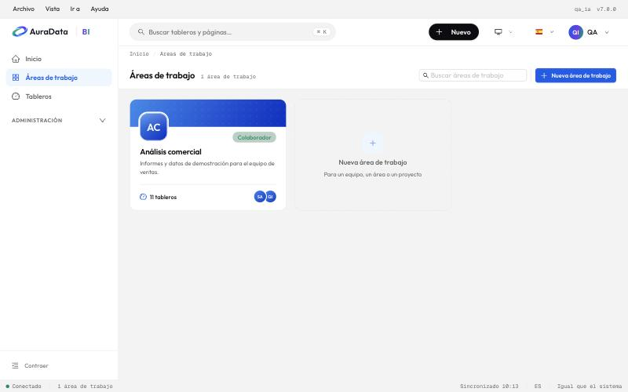
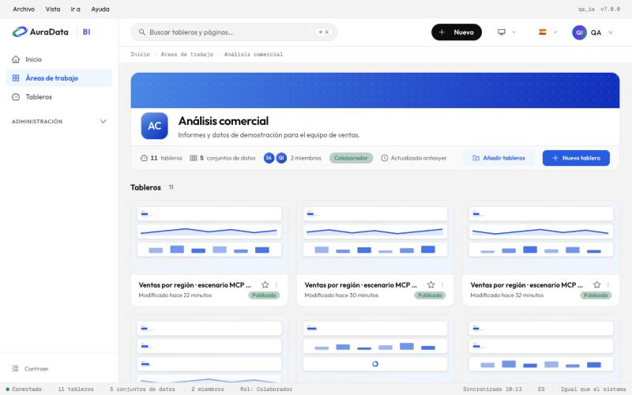

# 1. Inicio y áreas de trabajo

## La ventana

Arriba del todo hay una barra de menús, como en una aplicación de escritorio: **Archivo**, **Vista**, **Ir a** y
**Ayuda** (en un informe, además, **Filtros**, **Exportar** y **Compartir**). Debajo, la barra superior con el
buscador (`⌘K` o `Ctrl+K`), el botón **Nuevo**, el idioma y tu menú de usuario. A la izquierda, la barra lateral; abajo,
una barra de estado con el estado del servidor, las cifras de la página, el idioma y el tema (claro, oscuro o igual
que el sistema).

La barra lateral tiene:

- **Inicio**: los tableros que editaste hace poco y tus favoritos.
- **Áreas de trabajo**: los espacios de tu equipo.
- **Tableros**: todos los informes que puedes ver, en una tabla con filtros. Con clic derecho sobre una fila
  aparecen sus acciones.
- **Administración**: **Conexiones** (las bases de datos, para administradores) y **Conectar IA**.

**Archivo › Abrir reciente** lista los informes que abriste en este navegador.

## Áreas de trabajo

Un área de trabajo agrupa los informes de un equipo, un área o un proyecto, con sus miembros y sus conjuntos de
datos. Es lo mismo que un workspace de Power BI.

Cada tarjeta dice tu rol, cuántos tableros tiene y quiénes son sus miembros. **Nueva área de trabajo** crea una.

Dentro de un área ves sus **tableros** y sus **conjuntos de datos**. Desde ahí creas un tablero nuevo, añades
tableros que ya existían y gestionas los miembros.

### Roles

| Rol | Qué puede hacer |
| --- | --- |
| **Lector** | Ver los informes del área |
| **Colaborador** | Además, crear y editar sus informes, usar sus conjuntos de datos, ver la papelera y el historial |
| **Administrador** | Además, gestionar los miembros y el área, y certificar sus informes |

Un rol de área nunca te hace editor de un informe en el sentido de Superset: editas por ser colaborador o
administrador del área. Certificar un informe (el sello de «certificado») es solo de sus editores y de los
administradores del área.

### Conjuntos de datos del área

Como los modelos semánticos de Power BI, un conjunto de datos pertenece a un área o es compartido (sin área). Un
informe solo usa conjuntos de datos de su área o compartidos, y los colaboradores y administradores del área pueden
leer los del área aunque no tengan acceso a la base de datos. Los lectores no ganan ese acceso: ven los datos a
través de los informes. La seguridad por filas (RLS) se aplica siempre.

## Un informe, un sitio

En AuraData BI cada gráfico pertenece a un solo informe: se crea y se edita desde ese informe (no hay una lista
suelta de gráficos). Los conjuntos de datos y SQL Lab también se abren desde el informe, en su menú **Datos**,
mientras lo editas.
