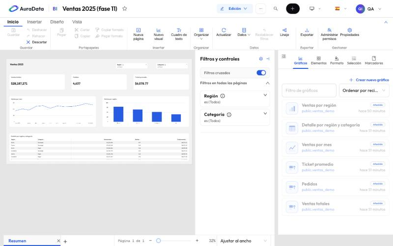
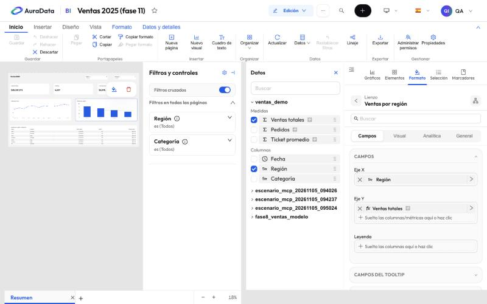
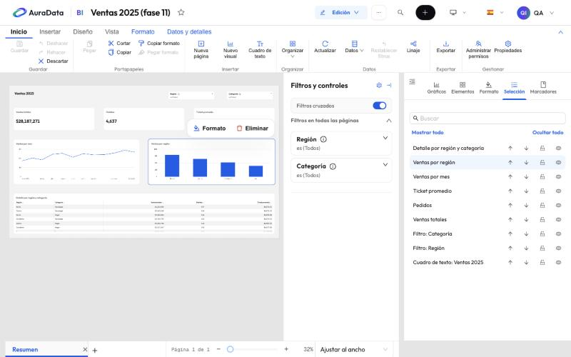

# 2. El editor de informes

Abre un informe y pulsa **Editar tablero**. El informe pasa a modo **Edición**: arriba aparece la cinta, a la derecha
los paneles y abajo la barra de páginas.

## La cinta

Como en Power BI, la cinta agrupa los comandos en pestañas:

| Pestaña | Para qué |
| --- | --- |
| **Inicio** | Guardar, deshacer y rehacer, portapapeles (cortar, copiar, pegar, copiar formato), insertar página o visual, organizar, actualizar datos, restablecer filtros, linaje, exportar, permisos y propiedades |
| **Insertar** | Páginas, visuales y elementos de diseño |
| **Diseño** | Tamaño de página, fondo, panel de filtros y estilo |
| **Vista** | Diseño móvil, ajustar a la página o al ancho, tamaño real, líneas de cuadrícula, bloquear objetos y qué paneles se muestran |
| **Formato** | Aparece al seleccionar un objeto: editar interacciones, organizar, estado del objeto |
| **Datos y detalles** | Aparece al seleccionar un visual: editarlo, actualizarlo y obtener detalles |

Los ajustes no viven en la cinta sino en los paneles; la cinta los abre.

## El lienzo

Cada página es un lienzo de tamaño fijo (16:9 por defecto) dividido en celdas cuadradas. Los objetos se colocan en
una celda y no empujan a los demás: mover o cambiar de tamaño uno nunca mueve otro. Mientras editas, la página es un
límite: un objeto no puede salirse de ella.

La barra de abajo tiene las pestañas de las páginas (el **+** añade una), «Página 1 de 2» y el zoom.

## Los paneles

A la derecha, en pestañas:

- **Gráficos**: los visuales del informe. **Crear nuevo gráfico** abre el editor de gráficos al lado del informe.
- **Elementos**: textos, imágenes, formas, botones, filtros del lienzo y navegadores de páginas
  ([capítulo 4](04-elementos-y-segmentadores.md)).
- **Formato**: el formato de la página o del objeto seleccionado ([capítulo 3](03-formato.md)).
- **Selección**: todos los objetos de la página, por capas.
- **Marcadores**: los marcadores del informe ([capítulo 5](05-interactividad.md)).

### Campos y datos

Con un visual seleccionado, **Formato › Campos** muestra sus campos (eje X, eje Y, leyenda, campos del tooltip…).
El panel **Datos**, a su lado, lista los conjuntos de datos que puede usar el informe, con sus medidas y columnas:
marca una, o arrástrala a un campo o sobre el gráfico.

Los cambios de campos se ven al momento y se guardan con el informe. «Usar esta tabla en el gráfico» cambia el
conjunto de datos de un visual de una vez.

### Selección

El panel **Selección** lista los objetos de la página. Desde ahí cambias el orden de las capas, **bloqueas** un
objeto (no se mueve ni se borra) y lo **ocultas** a los lectores (en edición se ve atenuado).

**Vista › Bloquear objetos** bloquea todo el informe, solo para ti y solo en este navegador.

## Guardar

**Guardar** (`Ctrl+S`) guarda todo: diseño, formato, campos y marcadores. **Descartar** vuelve a la última versión
guardada. Cada guardado queda en el historial de versiones ([capítulo 8](08-papelera-e-historial.md)).
