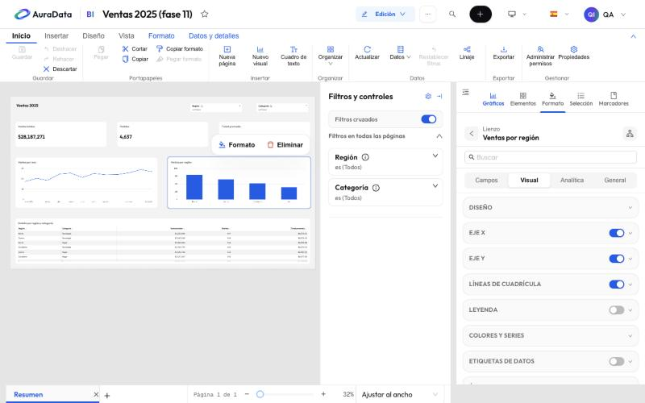

# 3. Formato del lienzo y de los visuales

Todo el formato se guarda con el informe: se deshace con **Deshacer**, viaja al exportar y queda en el historial.

## El lienzo

Sin nada seleccionado, el panel **Formato** muestra la página:

- **Tamaño de página** (también en **Diseño**): 16:9 (el de siempre, Full HD), 4:3, carta o un tamaño propio. Todos
  los presets comparten la altura del 16:9.
- **Fondo** del lienzo y **fondo de la página** (color o imagen, con ajuste y opacidad).
- Si la página es una página tooltip o de obtener detalles ([capítulo 5](05-interactividad.md)).

El informe se ve claro u oscuro según el color de fondo del lienzo: no hay otro ajuste de apariencia.

## Un visual

Selecciona un gráfico y abre **Formato** (o el botón **Formato** que aparece sobre él). El panel tiene cuatro
niveles:

| Nivel | Qué cambia |
| --- | --- |
| **Campos** | Qué datos muestra ([capítulo 2](02-editor.md#campos-y-datos)) |
| **Visual** | El gráfico en sí: diseño, ejes, líneas de cuadrícula, leyenda, colores y series, etiquetas de datos… |
| **Analítica** | Líneas de referencia, tendencia, campos del tooltip y múltiplos pequeños |
| **General** | La caja: título, subtítulo, fondo, borde, sombra, espaciado, iconos del encabezado, botón de acción, enlace, tooltip y texto alternativo |

Las secciones dependen del tipo de gráfico: una tarjeta tiene valor, etiqueta y objetivo; una tabla, cuadrícula,
encabezados y formato condicional; las barras y las líneas, series una por una, eje secundario y zoom. El buscador
de arriba encuentra un ajuste por su nombre.

## Formato de todos a la vez

- **Aplicar a todos los gráficos** (en el panel **Formato** del visual) copia el estilo del visual a todos los del informe.
  Un gráfico puede cambiar después un ajuste suyo: su ajuste gana.
- **Copiar formato** (en **Inicio**) copia el formato de un visual y **Pegar formato** lo aplica a otro.

Lo que solo tiene sentido en un gráfico (su subtítulo, su objetivo, el texto de su botón de acción…) no se copia
nunca.

## Los colores

Las paletas son las de AuraData: Azul Aura, violeta y verde, con variantes. Para destacar una serie, cámbiala en
**Colores y series**.
