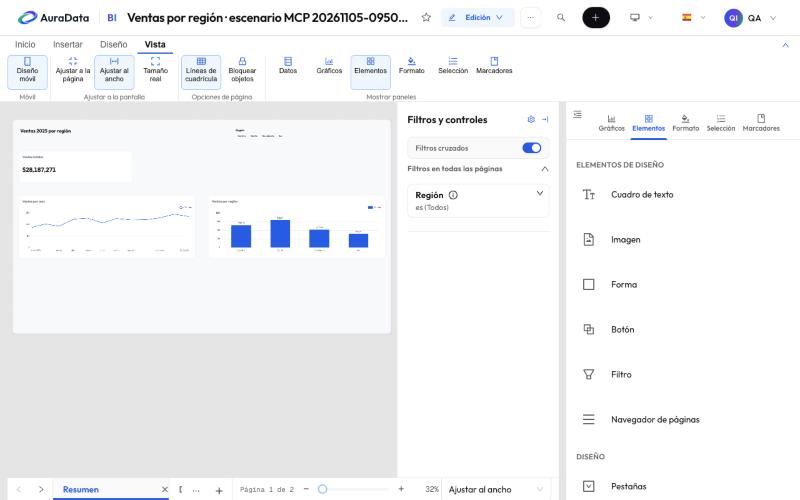
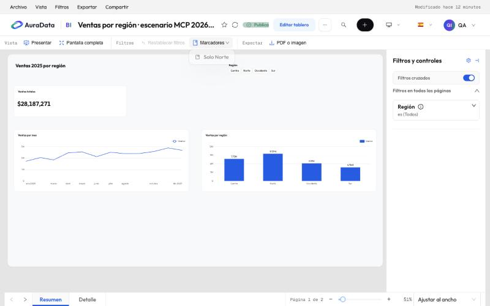

# 4. Elementos y segmentadores

El panel **Elementos** (o la pestaña **Insertar** de la cinta) tiene lo que no es un gráfico. Arrástralo al lienzo y
cae en la celda donde lo sueltas.

## Elementos de diseño

| Elemento | Para qué |
| --- | --- |
| **Cuadro de texto** | Títulos, notas, explicaciones |
| **Imagen** | Logos y fotos, que se suben al informe |
| **Forma** | Rectángulos, círculos y líneas para agrupar visualmente |
| **Botón** | Ir a una página, aplicar un marcador, volver atrás, restablecer filtros, subir al principio o abrir un enlace |
| **Filtro** | Un segmentador sobre el lienzo (abajo) |
| **Navegador de páginas** | Botones para cambiar de página |

Cada elemento tiene su formato en el panel **Formato**: fondo, borde, sombra, texto, acción.

## Segmentadores

Un segmentador (el elemento **Filtro**) es un filtro del informe dibujado sobre la página. Filtra los gráficos de
esta página o de todo el informe, y puede salir también en el panel **Filtros y controles** o solo en el lienzo.

Según el tipo de filtro, se dibuja así:

| Filtro | Estilos |
| --- | --- |
| Lista de valores | **Desplegable**, **lista**, **botones** o **texto** |
| Rango numérico | Dos casillas («entre») o un deslizador |
| Fechas | Fecha relativa («último mes») o dos días |

En **Formato** eliges:

- **Tipo de segmentador**, la selección (un valor, varios, o uno por clic y más con `Ctrl`) y si espera a **Aplicar**;
- el orden de los valores y los que quieres esconder (siguen contando en los gráficos);
- la disposición: los valores se apilan en columna; en fila (lo habitual para botones) o en cuadrícula;
- el aspecto de los valores, el título y la caja.

Un filtro que solo admite un valor se queda con uno aunque el segmentador diga otra cosa.

