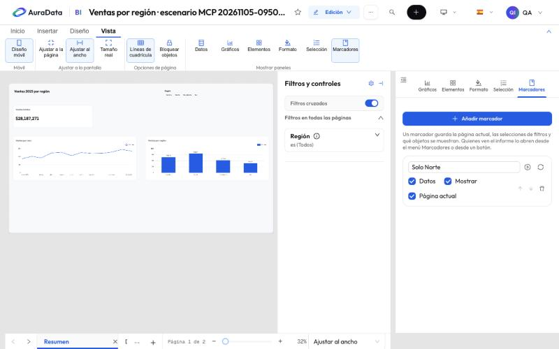

# 5. Interactividad

Lo que hace que un informe responda a quien lo lee. Todo se prepara en el editor y se usa en modo lectura.

## Filtros cruzados y filtros por nivel

Un clic en una barra, un punto o una fila filtra los demás gráficos (filtros cruzados; se apagan en el panel
**Filtros y controles**). Los filtros del panel valen para **todas las páginas**, **esta página** o **visuales
concretos**, y pueden aplicarse al instante o esperar a **Aplicar**.

## Editar interacciones

Con un visual seleccionado, **Formato › Editar interacciones** marca sobre cada uno de los demás si el primero lo
**filtra** o **no le hace nada**. Se guarda con el informe.

## Marcadores

Un marcador guarda la página actual, las selecciones de filtros y qué objetos se ven. En el panel **Marcadores**:
**Añadir marcador**, renombrar, actualizar con lo que ves ahora y elegir qué guarda (**Datos**, **Mostrar**,
**Página actual**).

Quien lee el informe los abre desde el menú **Marcadores** de la barra de lectura o desde un botón del lienzo.

## Obtener detalles

Una página de detalle (drill through) recibe el valor sobre el que se hizo clic. Selecciona la página, abre
**Formato** sin nada seleccionado e indica qué columnas acepta. En lectura, clic derecho sobre una barra o una fila ›
**Obtener detalles** abre esa página filtrada por ese valor, con un botón para volver. También está en **Datos y
detalles** de la cinta.

## Sincronizar segmentadores

En el formato de un segmentador, **Sincronizar segmentaciones** elige en qué páginas filtra y pone copias del
segmentador en otras páginas, que comparten su selección.

## Páginas tooltip

Una página con **Usar como información sobre herramientas** se convierte en un tooltip: tiene su propio tamaño
(pequeño), no la ven los lectores en la lista de páginas y se dibuja al pasar el ratón por un visual. En el visual,
**General › Información sobre herramientas** elige esa página o deja la automática (la que agrupa por las mismas
columnas).

## Restablecer filtros

**Restablecer filtros** (en la barra de lectura y en **Inicio**) deja todos los filtros y segmentadores en su valor
por defecto, quita los filtros cruzados, sale de un «obtener detalles» y deshace lo que mostró u ocultó un marcador.

## Páginas ocultas

Desde el menú de una página, **Ocultar página** la quita de las pestañas y de los navegadores de los lectores. Los
enlaces, los botones y «obtener detalles» la siguen abriendo.
