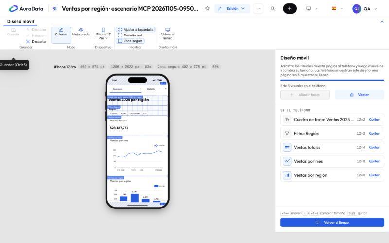

# 6. Diseño móvil

En un teléfono, un informe se ve igual que en el ordenador, escalado al ancho de la pantalla. Si quieres que una
página se lea mejor en el teléfono, dale un **diseño móvil**: los mismos objetos de la página, colocados de nuevo en
una página estrecha de 12 celdas de ancho.

Ábrelo con **Vista › Diseño móvil**. La página se muestra dentro de un iPhone y la cinta pasa a la pestaña
**Diseño móvil**.

- A la derecha están los visuales de la página: **Añadir** pone uno en el teléfono, **Añadir todos** los pone todos
  y **Vaciar** los quita. Dentro del teléfono los mueves y cambias de tamaño (también con las flechas del teclado).
- **Colocar** edita; **Vista previa** muestra la página como la verá alguien en su teléfono.
- **Dispositivo** cambia el modelo de teléfono; **Ajustar a la pantalla**, **Tamaño real** y **Zona segura** son
  solo para ver mejor (se recuerdan en tu navegador, no en el informe).
- **Volver al lienzo** sale.

Cada página tiene su propio diseño móvil. Una página sin él se muestra en el teléfono como su lienzo. Nada cambia de
diseño solo: si después añades un gráfico a la página, añádelo también al teléfono.
