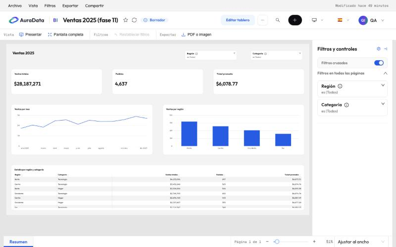
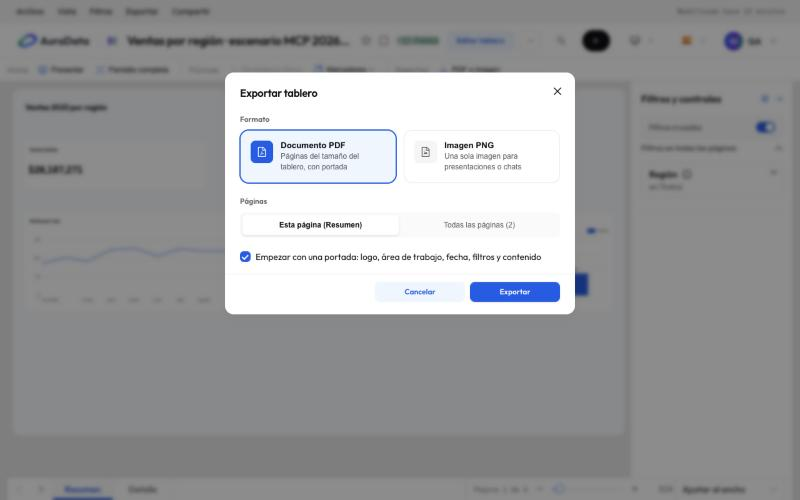

# 7. Modo lectura, presentar y exportar

## Modo lectura

Así ve un informe quien lo lee: sin la barra lateral, con el logo y el título arriba y una barra de comandos debajo:

- **Vista**: **Presentar** y **Pantalla completa**;
- **Filtros**: **Restablecer filtros** y **Marcadores**;
- **Exportar**: **PDF o imagen**.

A la derecha está el panel **Filtros y controles**, que se pliega en una franja. Cada filtro es una tarjeta que dice
qué selecciona («es (Todos)», «es Norte») y lleva una marca de color cuando filtra algo. Abajo, la barra de páginas:
flechas, pestañas, «Página 1 de 2» y el zoom (**Ajustar al ancho**, **Ajustar a la página**).

La barra de menús de arriba repite todo en **Archivo**, **Vista**, **Filtros**, **Exportar** y **Compartir**, y el
botón **⋯** junta además actualizar, guardar como, descargar, compartir y el historial de versiones.

Un informe es un **borrador** hasta que se publica: solo lo ven sus editores y los colaboradores y administradores de
su área. **Publicado**, lo ven todos los que tienen acceso.

## Presentar

**Presentar** muestra el informe a pantalla completa, página por página, con las pestañas arriba y el panel de
filtros a un lado. Las flechas del teclado cambian de página y `Esc` sale.

## Exportar

**Exportar › PDF o imagen** abre este diálogo:

- **Documento PDF**: una página por página del informe, a su tamaño, con una portada opcional (logo, área de
  trabajo, fecha, filtros aplicados y contenido).
- **Imagen PNG**: una sola imagen, para presentaciones o chats.
- **Esta página** o **Todas las páginas**. Las páginas ocultas y las tooltip se quedan fuera.

El archivo sale con los filtros que tienes puestos.

## Compartir y envíos programados

**Compartir** copia un enlace al informe con sus filtros. Un envío programado por correo (por ejemplo, el PDF cada
lunes) se envía con los permisos del editor del informe; puedes pedírselo a una IA conectada
([capítulo 9](09-conectar-ia.md)).
