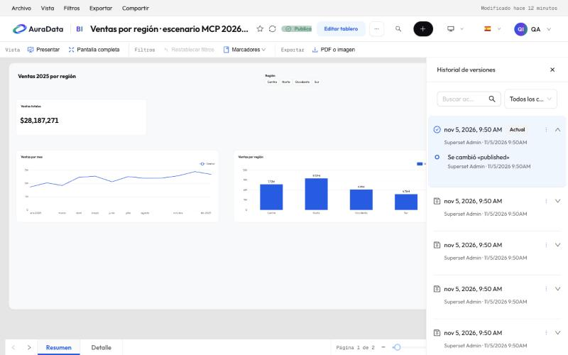

# 8. Papelera e historial

Nada se pierde de golpe: lo borrado va a la papelera y cada cambio guardado deja una versión.

## Papelera

Un tablero, un gráfico o un conjunto de datos borrado se queda en la papelera, con sus vínculos. Hay dos:

- La del **área de trabajo**, al final de su página, para sus colaboradores y administradores. Solo aparece cuando
  tiene algo.
- La de **Administración › Papelera** (`/archived/`), si tu rol la tiene: todo lo borrado que puedes editar (los
  administradores, todo).

**Restaurar** lo devuelve a su sitio. Si algo lo impide (por ejemplo, un gráfico que ya está en otro informe), la
papelera lo dice. Lo que lleva mucho tiempo en la papelera se borra solo.

## Historial de versiones

En el menú **⋯** de un informe, **Ver historial de versiones** abre la lista de versiones, la más nueva arriba, con
quién y cuándo. Despliega una para ver qué cambió.

Desde el menú de una versión puedes restaurarla: el informe vuelve a ese estado y eso crea una versión nueva, así que
también se puede deshacer. Restaurar respeta las reglas del producto: un gráfico no vuelve a un informe si ya está
en otro, ni a un conjunto de datos de otra área.

Los colaboradores ven el historial de los informes de su área y pueden copiar un informe (la copia queda en la misma
área).

Los cambios que hace una IA conectada con tu clave también quedan aquí, a tu nombre ([capítulo 9](09-conectar-ia.md)).
