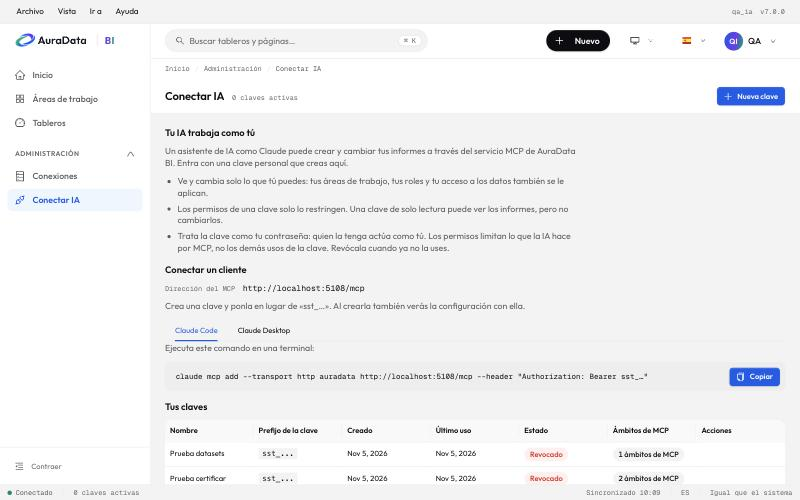

# 9. Conectar IA

Una IA como Claude puede armar y cambiar tus informes por ti: le pides «arma un informe de ventas por región» y crea
las páginas, los gráficos, el formato, los segmentadores y el diseño móvil, mira el resultado y lo corrige.

**Conectar IA** está en **Administración** de la barra lateral, en el menú **Archivo** y en tu menú de usuario. Ahí:

1. Creas una **clave personal** (**Nueva clave**) y eliges sus permisos: por defecto solo de lectura.
2. Copias la configuración de tu cliente (Claude Code o Claude Desktop), ya rellenada con la clave.
3. Revocas una clave cuando ya no la uses.

Lo importante:

- **La IA trabaja como tú**: ve y cambia solo lo que tú puedes, y sus cambios quedan en el historial a tu nombre.
- **Trata la clave como tu contraseña**: quien la tenga actúa como tú.
- **Las contraseñas nunca pasan por el chat**: las conexiones a bases de datos las crea un administrador en la web.

La guía completa, con la configuración de cada cliente y ejemplos de encargos, está en
[mcp/conectar.md](../mcp/conectar.md).

## ¿Asistente o Conectar IA?

AuraData BI tiene dos caminos para trabajar con una IA, y no se mezclan.

| | [Asistente de IA](10-asistente-de-ia.md) | Conectar IA (este capítulo) |
| --- | --- | --- |
| Dónde la usas | En un panel dentro de la aplicación, con tu sesión | En tu propio cliente, como Claude Code o Claude Desktop |
| Qué necesitas | Que un administrador lo encienda | Una clave personal `sst_…` y tu propio cliente de IA |
| Quién paga | La clave de Anthropic del servidor, con topes de gasto | Tu propia cuenta de IA |
| Qué la frena | Tarjetas de confirmación y **Deshacer lo del asistente** | Los permisos de tu clave y lo que pregunte tu cliente |

En los dos casos la IA actúa como tú, con tus mismos permisos, y sus cambios quedan en el historial. Una clave `sst_…` no
sirve para el chat del panel.
