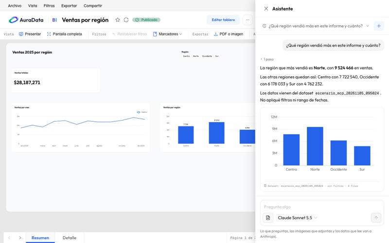
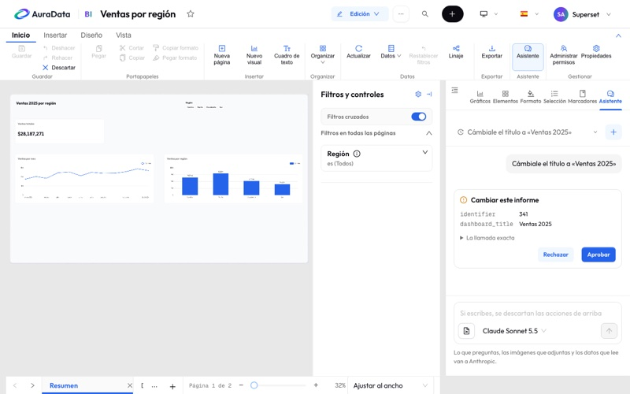
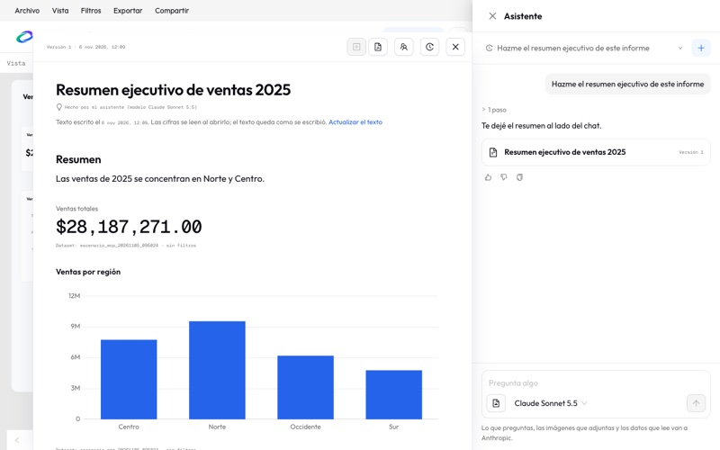
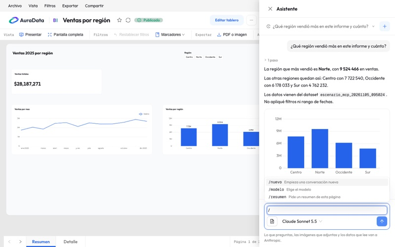

# 10. Asistente de IA

El asistente es un panel de chat dentro de AuraData BI: le preguntas por tus datos mientras lees un informe, o le pides
cambios mientras lo editas. Corre sobre Claude, de Anthropic, y trabaja siempre con tus permisos.

| Dónde estás | Cómo se llama | Qué hace |
| --- | --- | --- |
| Leyendo un informe | **Pregúntale a tus datos** | Responde sobre los datos. No puede cambiar nada |
| Editando un informe | **Asistente** | Cambia el informe guardado, y te pregunta antes de lo delicado |

> **Sobre las capturas.** Son de la aplicación real, sobre una copia de evaluación, y se tomaron sin llamar al modelo. La respuesta
> de esta primera es la de una corrida real, acortada. Los textos de las otras se escribieron para la captura.

¿Buscas usar tu propia IA, como Claude Code o Claude Desktop? Eso es otra cosa: mira
[9. Conectar IA](09-conectar-ia.md#asistente-o-conectar-ia).

## Antes de empezar

- **Si no ves el botón,** el asistente está apagado o le falta configuración. Lo decide un administrador, y un área de
  trabajo también puede apagarlo para sí misma.
- **La primera vez** aparece el aviso **Antes de empezar**, que dice qué se envía a Anthropic. Hasta que pulses
  **Entendido, continuar** no se envía nada. Se acepta una vez por persona, y vuelve a salir si el aviso cambia.

## Preguntar mientras lees

1. Abre un informe. En la barra de comandos, grupo **Asistente**, pulsa **Pregúntale a tus datos**. En un teléfono es el
   botón flotante **Preguntar**, y el panel ocupa toda la pantalla.
2. Escribe y pulsa `Enter`. `Mayús + Enter` cambia de línea.
3. Lee la respuesta. Mientras trabaja, el panel muestra qué está haciendo; **Detener** corta la respuesta. Puedes cerrar el
   panel o recargar la página: la respuesta sigue en el servidor, y al volver la encuentras donde iba. Entre sus pasos
   pueden salir notas del modelo sobre lo que acaba de ver y lo que sigue. Al terminar se pliegan en una línea, «N pasos», que
   se abre con un clic. No todas las respuestas traen notas.

Responde sobre **la página y los filtros que tienes en pantalla**, salvo que le pidas otra cosa. Por ejemplo:

- «¿Qué región vendió más en este periodo?»
- «¿Por qué bajó marzo respecto a febrero?»
- «¿De dónde sale esta cifra?»

Una respuesta con cifras dice de qué dataset y con qué filtros salen. Si consultó un dataset, debajo del texto dibuja un
gráfico chico con esa consulta, y si no se puede dibujar deja las filas en una tabla. Esa consulta la repite AuraData BI
con tus permisos, así que si no tienes acceso a esos datos, no se dibuja.

## Adjuntar una imagen

Sirve, por ejemplo, para pasarle la captura de un informe de Power BI y pedirle que lo replique en el editor.

- **Pega** una captura con `Ctrl + V` (`Cmd + V` en Mac), **arrástrala** al panel o pulsa el botón de imagen junto al modelo.
- Admite **PNG, JPEG y WEBP**, de hasta **8 MB**. Un mensaje lleva hasta **5 imágenes** y una conversación hasta **20**.
- La miniatura sale en el mensaje. La **×** la quita antes de enviar. Después de enviarla, la imagen se queda en la conversación
  hasta que la elimines.
- Puedes enviar una imagen sin texto, aunque le ayuda saber qué quieres.

Una imagen muy grande se reduce, y se le quitan los metadatos, como la ubicación de una foto. El asistente la vuelve a leer en
cada mensaje de esa conversación, así que **conviene adjuntar solo lo que hace falta**, y recortar la captura si el texto es
chico. Lo que diga el texto de una imagen no es una orden para el asistente: te avisa y sigue lo que tú escribiste.

## Copiar y votar una respuesta

Debajo de cada respuesta terminada hay tres botones pequeños. Mientras escribe o espera una tarjeta, no aparecen.

- **Copiar** lleva el texto de la respuesta y, si trae una tabla, sus filas separadas por tabuladores, para pegarlas en
  una hoja de cálculo. El botón dice **Copiado**.
- **Útil** y **No útil** son tu voto. Se guarda al instante, sigue ahí cuando recargas y puedes cambiarlo. Otro clic en el
  mismo botón lo quita.
- Con **No útil** puedes decir **qué falló**: cifras incorrectas, no es lo que preguntaste, incompleta u otra cosa. Es
  opcional.

Solo votas en tus propias conversaciones. Los administradores ven cuántos votos hubo por modelo y por área de trabajo,
nunca quién votó qué ni el texto de la conversación.

## Pedir cambios mientras editas

Abre el informe en modo edición y entra por **Inicio › Asistente** en la cinta, o por la pestaña **Asistente** de los
paneles. Solo aparece si puedes editar ese informe.

El asistente conoce la página activa y los objetos que tienes seleccionados, con su formato. Así «ponle borde a este
gráfico» sabe cuál es «este». Otros ejemplos:

- «Agrega un gráfico de barras de ventas por región en esta página.»
- «Alinea estas tarjetas y dales el mismo tamaño.»
- «Agrega un segmentador de año arriba a la derecha.»

**Trabaja sobre el informe guardado.** Si tienes cambios sin guardar, el panel te pide **Guardar** o **Descartar** antes
de seguir. Cuando el asistente termina, el editor recarga el informe sin salir del modo edición. Si editaste algo mientras
respondía, el editor no tira tu trabajo: te avisa, y para ver lo del asistente tienes que descartar tus cambios.

## Las tarjetas de confirmación

Para lo delicado, el asistente se detiene y muestra una tarjeta con la acción y sus datos exactos. Nada de eso corre hasta
que pulses **Aprobar**; **Rechazar** lo descarta.

Piden tarjeta las acciones que:

| Tipo | Ejemplos |
| --- | --- |
| Borran o quitan | Un gráfico, una página, un elemento, un marcador, un informe, el diseño móvil |
| Sobrescriben | Cambiar un gráfico o los ajustes del informe, cambiar sus filtros, cambiar una métrica o una columna calculada |
| Publican, comparten o programan | Publicar, compartir, crear o cambiar un informe programado o una alerta |
| Cambian quién entra | Editores y visores del informe, miembros de un área de trabajo |
| Restauran o mueven | Volver a una versión, sacar algo de la papelera, mover a otra área de trabajo |
| Ejecutan SQL | Cualquier sentencia que el asistente quiera correr |

Lo demás, como dar formato o agregar una página, se hace sin tarjeta y se puede [deshacer](#deshacer).

Cómo se comportan:

- **Se decide una por una.** Si un paso trae varias tarjetas, nada corre hasta que las contestes todas.
- **Si rechazas una,** tampoco corren las acciones sin tarjeta de ese paso. Las que aprobaste sí corren.
- **Si escribes en vez de decidir,** las acciones pendientes se descartan. El cuadro de texto te lo recuerda.
- **Pueden esperar.** Si cierras el panel, la tarjeta sigue ahí cuando vuelves a esa conversación. Tus permisos se revisan
  otra vez cuando decides.
- **Solo tu clic aprueba.** Nada que escriba el modelo, ni el texto de un dataset, puede aprobar una tarjeta.

## Deshacer

Después de un turno que cambió el informe aparece **Deshacer lo del asistente**. Devuelve el informe y sus gráficos a como
estaban antes de ese turno. Si lo pulsas otra vez, deshace el turno anterior.

No funciona si:

- **El informe cambió después del turno.** Deshacer se lo llevaría también; vuelve atrás desde el
  [historial de versiones](08-papelera-e-historial.md).
- **Tienes cambios sin guardar** o una **tarjeta sin contestar**. Resuélvelos primero.

Lo que deshacer deja como está:

- **Un dataset que el asistente cambió.** Otros informes pueden leerlo, así que el cambio se queda.
- **Un gráfico que creó.** Sale del informe, pero no se borra.
- **Un gráfico que borró.** Sigue en la [papelera](08-papelera-e-historial.md), y de ahí se recupera.

Lo que hace el asistente queda en el historial con la marca **Hecho por el asistente (modelo)**, y el historial se filtra
con **Solo lo que hizo el asistente**. En el registro de acciones, cada herramienta usada es una fila, con el filtro
**Hecho por**.

## Pedir un documento

Pide un entregable, como «hazme el resumen ejecutivo de este informe», y el asistente lo escribe en un documento al lado del chat.
Funciona también mientras lees, porque un documento es tuyo y no cambia el informe. Solo tú lo ves, hasta que lo compartes.
Bajo el título dice qué modelo lo hizo.

Un documento tiene texto, cifras destacadas, gráficos y tablas. Las cifras, gráficos y tablas guardan su consulta, no el número: se
leen cada vez que lo abres, con tus permisos, y debajo dicen de qué dataset y filtros salen. Si ya no tienes acceso a un dato, ese
bloque lo dice.

- **Ajustarlo.** Sigue conversando: «quita la tabla», «agrega un párrafo sobre el Norte». Cada cambio es una versión nueva.
- **Cambiar un bloque.** Haz clic en un bloque y escribe qué cambiar, por ejemplo «acorta este párrafo» o «cambia este gráfico a
  líneas». Mientras esté seleccionado, el chat lo indica sobre tu mensaje.
- **Volver atrás.** Abre **Historial de versiones**, elige una y pulsa **Volver a esta versión**. Se agrega una versión nueva: no
  se pierde ninguna.
- **Actualizar el texto.** El texto queda como se escribió, aunque las cifras cambien. Bajo el título ves su fecha, y **Actualizar
  el texto** le pide al asistente que lo reescriba con las cifras de hoy.

Si borras la conversación, su documento se borra con ella, y lo mismo ocurre cuando vence la retención. Si estaba compartido,
deja de verse.

### Exportarlo a PDF

Pulsa **Exportar a PDF** en la barra del documento. Tarda unos segundos y se descarga solo. Sale tal como lo ves, con tus cifras y
en hojas A4.

### Guardarlo como página del informe

El documento se convierte en páginas de verdad: el texto en elementos de texto, y las cifras, gráficos y tablas en gráficos del
informe.

1. Abre el informe en el editor y, en una conversación de la pestaña **Asistente**, pulsa **Guardar como página del informe** o
   pídeselo.
2. Lee la tarjeta: dice cuántas páginas y cuántos objetos va a crear. Pulsa **Aprobar**.
3. El informe se recarga con las páginas nuevas. Si no te gusta, **Deshacer lo del asistente** las quita con un clic.

Si el documento lo escribiste mientras leías, ábrelo desde el editor pidiéndolo por su nombre: «guarda mi documento Resumen como
página». Si no cabe en una página sigue en otra, y si un bloque no se puede convertir exactamente, el asistente te dice cuál quedó
fuera.

### Compartirlo con tu área de trabajo

Compartes con todas las personas del área de trabajo del informe, y solo con ellas.

1. Pulsa **Compartir con el workspace** en la barra del documento.
2. Lee la tarjeta. Muestra las frases con cifras y por qué valores filtran los bloques.
3. Pulsa **Compartir la versión N**, y usa **Copiar enlace** si quieres mandarlo. También aparece en la página del área de trabajo,
   en **Documentos compartidos**.

**Lo que debes saber antes de compartir:**

- Los gráficos, las tablas y las cifras se leen con los permisos de cada persona. Si no llega a un dato, ve un aviso en su lugar.
- **El texto no.** Queda como lo escribió el asistente con tu acceso, y la seguridad por filas no lo alcanza. Si el texto dice
  «el Norte vendió 9 millones», eso lo lee todo el que abra el documento. Revísalo, o deja esas cifras en bloques de datos.
- Comparte una versión. Lo que cambies después no llega a nadie hasta que compartas otra vez.
- Quien lo lee no puede cambiarlo, ni ver la conversación ni las versiones, y ve una nota con quién lo escribió y cuándo.

Se deja de compartir con **Dejar de compartir**, y también cuando sales del área de trabajo o el informe pasa a otra. Si lo
compartes de un borrador, solo lo leen quienes pueden ver ese borrador.

## Elegir el modelo

El selector de arriba muestra los modelos que dejó un administrador, con una etiqueta de precio relativo y **por defecto**
en el suyo: **Económico**, **Equilibrado** o **Máximo**. Puedes cambiarlo cuando quieras.

- **Cambiar de modelo a mitad de conversación** funciona, pero esa respuesta tarda más y cuesta más, porque el modelo lee
  todo desde cero. El panel te lo avisa.
- **Un modelo gris** no puede seguir esa conversación. Empieza una **Nueva conversación**.
- **Si dudas,** usa el que viene por defecto: en la [comparación real](../asistente/evaluacion.md#recomendación-por-modo) fue el mejor
  equilibrio para editar informes. Para preguntas y documentos, un modelo económico acertó lo mismo.

Si una conversación se hace demasiado larga para el modelo, el panel te pide empezar otra.

## Comandos con /

Escribe `/` en la caja de preguntas y se abre una lista de atajos del panel. Muévete con las flechas, elige con Enter y
ciérrala con Escape. También funcionan con el ratón, y puedes escribir el nombre completo.

| Comando | En inglés | Qué hace |
| --- | --- | --- |
| `/nuevo` | `/new` | Abre una conversación nueva. La anterior sigue guardada |
| `/modelo` | `/model` | Abre el selector de modelo. Elige con las flechas y Enter, y vuelves a la caja de preguntas |
| `/resumen` | `/summary` | Pregunta «Resume esta página», como si la hubieras escrito tú |
| `/deshacer` | `/undo` | Lo mismo que **Deshacer lo del asistente**. Solo aparece cuando se puede deshacer |

Los dos nombres funcionan en cualquier idioma, y la lista muestra el de tu idioma. Un comando solo sale en la lista cuando se
puede usar: mientras el asistente responde no hay ninguno. Si escribes entero uno que ahora no se puede usar, el panel te lo
dice y no le pregunta nada al modelo.

Los comandos no te dan permisos nuevos y el modelo nunca los recibe: solo le llega la pregunta de `/resumen`. Un mensaje que
empieza con `/` pero no es un comando, como `/ventas del mes`, se envía como una pregunta normal.

## Tus conversaciones

Arriba del panel está la conversación abierta. Púlsala para ver **Conversaciones de este informe**, agrupadas por fecha y
separadas por modo: las de lectura no salen en el editor, ni al revés.

- **Buscar.** Escribe parte del título. No importan las mayúsculas ni los acentos.
- **Abrir.** Pulsa el título.
- **Cambiar el nombre.** Pulsa el lápiz, escribe y confirma con Intro. Con Esc lo dejas como estaba. El título es lo único que
  cambia: lo que se dijo sigue igual.
- **Eliminar.** Pulsa la papelera y confirma. Se borra lo que se dijo y los datos que leyó, y **no se puede recuperar**. Lo que
  el asistente cambió en el informe se queda, pero ya no puedes deshacerlo desde el panel.

Solo tú ves, renombras o eliminas tus conversaciones. Mientras el asistente responde hay que esperar a que termine.

Las conversaciones **se borran solas** a los 90 días de su último mensaje, salvo que tu administrador haya configurado otro
plazo. Una con una acción esperando tu decisión se queda hasta que la respondas.

## Privacidad

**Lo que escribes y los datos que el asistente lee se envían a la API de Anthropic.** Eso incluye:

- lo que escribes y la conversación hasta ese momento;
- las imágenes que adjuntas, sin sus metadatos, en cada mensaje de esa conversación;
- el informe, la página, los filtros y la selección que tienes en pantalla;
- el documento abierto y el bloque que selecciones;
- los datos que lee para responder, con sus filas.

Ve lo que tú ves y nada más. Por eso conviene pensar qué consultas: si tu acceso llega a datos personales, el asistente
también puede leerlos, y entonces viajan a Anthropic.

Las conversaciones se guardan en el servidor de AuraData BI, y en el panel solo tú puedes abrirlas. Puedes
[eliminarlas](#tus-conversaciones) cuando quieras. La pantalla de uso de los administradores muestra cuánto gastó cada persona y
los totales de votos, no lo que preguntó, y eso se mantiene después de eliminar una conversación. El registro de acciones sí guarda qué herramientas usó el
asistente y con qué parámetros, y no se borra con la conversación.

## Lo que no puede hacer

- **Más que tú.** Si no tienes permiso para algo, el asistente tampoco, y te lo dice.
- **Cambiar nada mientras lees.** En modo lectura solo responde; los cambios se piden desde el editor.
- **Ver tus cambios sin guardar.** Trabaja sobre lo guardado.
- **Recibir otros archivos.** Solo imágenes: un Excel, un CSV o un PDF no se pueden adjuntar.
- **Entregarte archivos,** salvo el PDF de un [documento](#exportarlo-a-pdf). Para el PDF o la imagen de un informe, usa
  [Exportar](07-lectura-presentar-exportar.md).
- **Mostrar imágenes ni enlazar fuera del sitio.** En sus respuestas el HTML queda como texto, no se cargan imágenes y solo
  funcionan los enlaces a este mismo sitio. Es una protección: un texto malicioso en un dataset podría intentar sacar
  datos en una dirección.
- **Encargos enormes de una vez.** Un mensaje tiene un límite de pasos. Si se pasa, te pide algo más acotado.
- **Funcionar fuera de tu sesión.** No responde en informes incrustados ni con claves personales `sst_…`.

## Si algo falla

| Qué ves | Qué significa | Qué hacer |
| --- | --- | --- |
| No está el botón | Apagado para todos, en esta área o sin clave | Pregúntale a un administrador |
| Sale en lectura y no en el editor | Esta área solo deja preguntar, o no puedes editar el informe | Pregúntale a un administrador del área |
| Aviso de que queda poco presupuesto | Se gastó el 80% del tope del mes | Sigue funcionando; se detendrá al 100% |
| No deja escribir y habla del presupuesto | Se acabó el tope del mes | Espera al mes siguiente o pídeselo a un administrador |
| Dice que no encuentra el dataset, o no da cifras | Tu rol no tiene acceso a esos datos | Pídele acceso a un administrador |
| Mensaje de que el servicio de IA falló | Saturación, sin saldo, clave rechazada o sin conexión | Reintenta; si dice que avises, avísale a un administrador |
| Dice que la conversación es demasiado larga | Ya no cabe en lo que el modelo puede leer | Pulsa **Nueva conversación** en ese aviso. La anterior sigue guardada |
| «Usa una imagen PNG, JPEG o WEBP» | El archivo no es una de esas imágenes, aunque se llame así, o está dañado. SVG y GIF no se aceptan | Haz una captura de nuevo o guárdala como PNG |
| «Esta imagen tiene demasiados píxeles» o «pesa más de 8 MB» | La imagen supera lo que el servidor abre | Redúcela o recórtala |
| «Esta conversación ya no admite más imágenes» | Ya lleva 20 | Empieza una nueva |
| La conversación dice estar ocupada | Todavía está respondiendo, quizá en otra pestaña | Espera a que termine, o pulsa **Detener** |
| «No hay ningún worker del asistente libre» | El servidor no tiene dónde correr tu respuesta ahora | Prueba en un momento; si se repite, avísale a un administrador |
| «El asistente se detuvo antes de terminar» | Se cayó el proceso que la corría. La conversación sigue funcionando | Si estaba cambiando el informe, revísalo antes de pedirlo otra vez |
| «Esto tardó demasiado y se detuvo» | Pasó el tiempo de una respuesta, 20 minutos por defecto | Pide algo más acotado |

La guía para administradores está en [asistente/administracion.md](../asistente/administracion.md).
