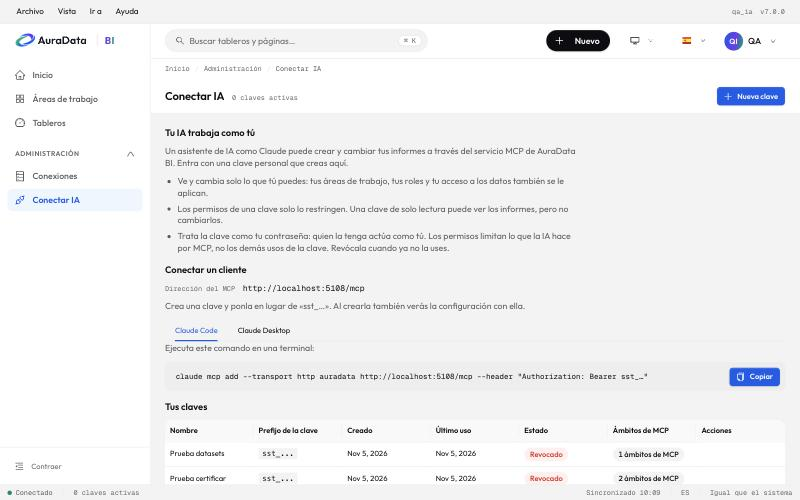

# Conectar una IA a AuraData BI

Una IA como Claude puede crear y cambiar tus informes de AuraData BI a través de su servicio MCP (Model Context
Protocol): arma páginas, gráficos, formato, segmentadores, marcadores y diseño móvil, mira el resultado con una
captura y lo corrige. Entra con una **clave personal** que creas en «Conectar IA».



## Lo que tienes que saber antes

- **La IA trabaja como tú.** Ve y cambia solo lo que tú puedes: tus workspaces, tu rol en cada uno y tu acceso a los
  datos se le aplican igual que en la web. Cada cambio queda en el historial de versiones con tu nombre, y se
  deshace restaurando una versión.
- **Los permisos de la clave solo restringen.** Una clave de solo lectura puede mirar informes, pero no cambiarlos.
  Nunca te da más de lo que ya tienes.
- **Trata la clave como tu contraseña.** Quien la tenga actúa como tú. Los permisos de la clave limitan lo que la IA
  hace por MCP, pero la misma clave también sirve contra la API REST de AuraData BI, y ahí actúa con **todos** tus
  permisos. No la pegues en un chat, en un repositorio ni en un documento compartido, y revócala cuando ya no la
  uses.
- **Las contraseñas nunca pasan por el chat.** La IA no da de alta conexiones a bases de datos: un administrador las
  crea en la web («Conexiones») y la IA las lista, las prueba y las usa. Si un encargo necesita una conexión que no
  existe, la IA te lo dice en vez de pedirte la contraseña.

## 1. Crea una clave

1. Abre «Conectar IA»: está en el menú **Archivo**, en tu menú de usuario (arriba a la derecha) y en
   **Administración** de la barra lateral. Su dirección es `/connect-ai/`.
2. Pulsa **Nueva clave** y ponle un nombre que diga dónde la usas («Claude Code del portátil»).
3. Elige sus **ámbitos** (permisos). Tienen la forma `superset:<recurso>:<acción>`:
   - por defecto vienen marcados todos los de lectura (`…:read`) que tú puedes dar: la IA podrá mirar, no cambiar;
   - para que arme y cambie informes, añade `superset:dashboard:write` y `superset:chart:write`; para que cree
     datasets o métricas, `superset:dataset:write`;
   - si dejas la lista vacía, la clave no tiene más límite que tus propios permisos.

   Solo aparecen los ámbitos que tus roles te dejan dar.
4. Pulsa **Guardar**. La clave (`sst_…`) se muestra **una sola vez**, junto con la configuración de Claude Code y
   Claude Desktop ya rellenada con ella. Cópiala en ese momento.

La [referencia de herramientas](referencia.md) dice qué ámbito pide cada herramienta.

## 2. Configura tu cliente

La página muestra la **dirección del MCP** de tu instalación (en desarrollo, `http://localhost:5108/mcp`). En los
ejemplos, cambia la dirección y `sst_…` por las tuyas.

### Claude Code

Ejecuta en una terminal:

```bash
claude mcp add --transport http auradata http://localhost:5108/mcp --header "Authorization: Bearer sst_…"
```

### Claude Desktop

Claude Desktop solo arranca servidores locales, así que usa `mcp-remote` como puente; necesita Node.js. Añade esto a
`claude_desktop_config.json` (Ajustes › Desarrollador › Editar configuración) y reinicia Claude Desktop:

```json
{
  "mcpServers": {
    "auradata": {
      "command": "npx",
      "args": [
        "-y",
        "mcp-remote",
        "http://localhost:5108/mcp",
        "--header",
        "Authorization:${AURADATA_AUTH}",
        "--allow-http"
      ],
      "env": {
        "AURADATA_AUTH": "Bearer sst_…"
      }
    }
  }
}
```

La cabecera va por una variable de entorno para que el espacio de `Bearer sst_…` no se parta en los argumentos.
`--allow-http` solo hace falta si la dirección empieza por `http://`; con `https://` la página no lo pone.

### Otros clientes

Cualquier cliente MCP que hable HTTP («streamable HTTP») y deje mandar una cabecera sirve: apúntalo a la dirección
del MCP con la cabecera `Authorization: Bearer sst_…`.

### Comprueba que funciona

Pídele a la IA: «¿qué workspaces tengo en AuraData BI?». Debe responder con los mismos que ves en la web. El servidor
le enseña pocas herramientas al principio y la IA busca las demás por su nombre o su función (`search_tools`), así
que es normal que no aparezcan las 146 en la lista del cliente.

## 3. Qué le puedes pedir

Encargos en lenguaje normal, en español:

- «Arma un informe de ventas por región con el dataset `ventas_demo` en el workspace Análisis comercial.»
- «Pon un segmentador de región como botones arriba a la derecha de la página Resumen.»
- «Haz que la página Detalle sea de obtener detalles por región.»
- «Revisa el informe 225 y corrige lo que no siga el estilo de AuraData.»
- «Prepara el diseño móvil de este informe y enséñame cómo queda en el teléfono.»
- «Mándame el informe en PDF cada lunes a las 8.»

Los clientes que muestran prompts (en Claude, el menú «/») ofrecen además encargos guiados:
`informe_desde_dataset`, `replicar_informe_power_bi` (desde una captura de Power BI), `revisar_informe` y
`diseno_movil`.

La lista completa de encargos de prueba, con lo que debe hacer la IA y cómo se ve un buen resultado, está en
[evaluacion.md](evaluacion.md). Todas las herramientas, con sus parámetros, en [referencia.md](referencia.md).

## 4. Revoca una clave

En «Conectar IA», en **Tus claves**, pulsa **Revocar** en la fila de la clave. Deja de funcionar al momento: el MCP
responde 401 a cualquier petición con ella. Revoca una clave cuando ya no la uses, cuando cambies de equipo o si
crees que alguien más la vio. Para seguir, crea otra y cambia la configuración del cliente.

## Si algo falla

| Síntoma | Causa probable |
| --- | --- |
| El cliente dice 401 o «unauthorized» | Falta la cabecera, la clave está mal copiada, revocada o caducada |
| La IA no tiene permiso para algo que tú sí haces en la web | A la clave le falta el ámbito de esa herramienta (la [referencia](referencia.md) lo dice): crea otra con él |
| La IA no ve un workspace o un dataset | Tampoco lo ves tú en la web: pide acceso a quien administra el workspace |
| La página dice «Las claves API están desactivadas» | Un administrador las enciende (ver abajo) |

## Para quien administra AuraData BI

- Las claves se encienden con `FAB_API_KEY_ENABLED` (más su flag del frontend) y `MCP_API_KEY_ENABLED`; vienen
  encendidas en las configuraciones de desarrollo y producción. Tras actualizar, `superset init` reparte a todos
  los roles el permiso de gestionar sus propias claves.
- Con `MCP_API_KEY_ENABLED` el MCP rechaza toda petición sin clave; `MCP_DEV_USERNAME` solo vale con las claves
  apagadas. En producción, un JWT (`MCP_JWT_SECRET`) sigue siendo una alternativa.
- `MCP_SERVICE_URL` es la dirección que muestra la página; sin ella, la página propone `/mcp` de la propia app.
